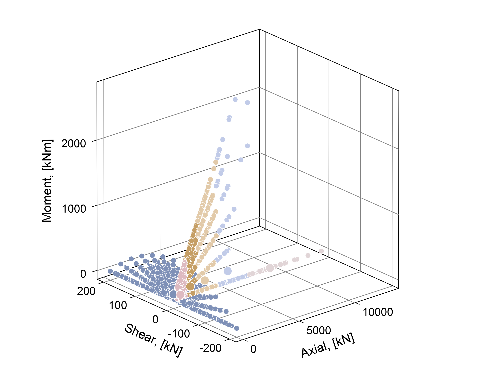
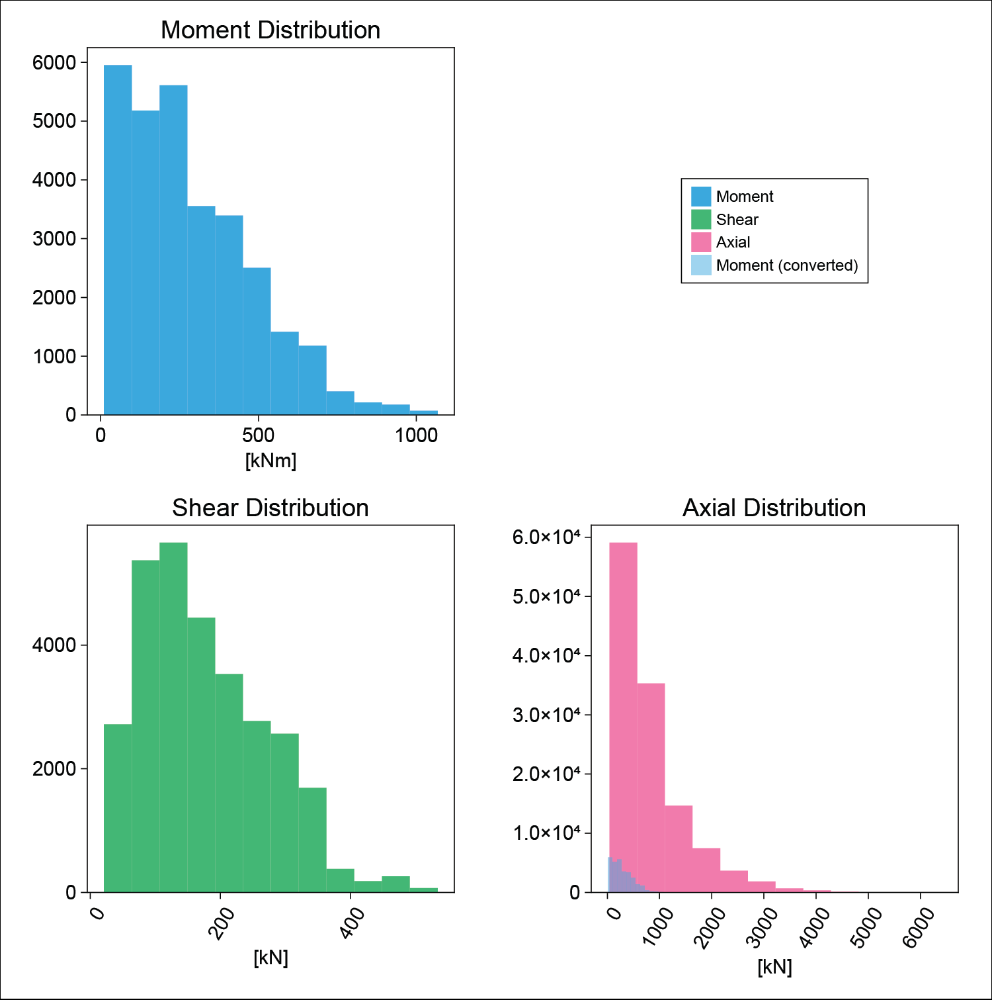
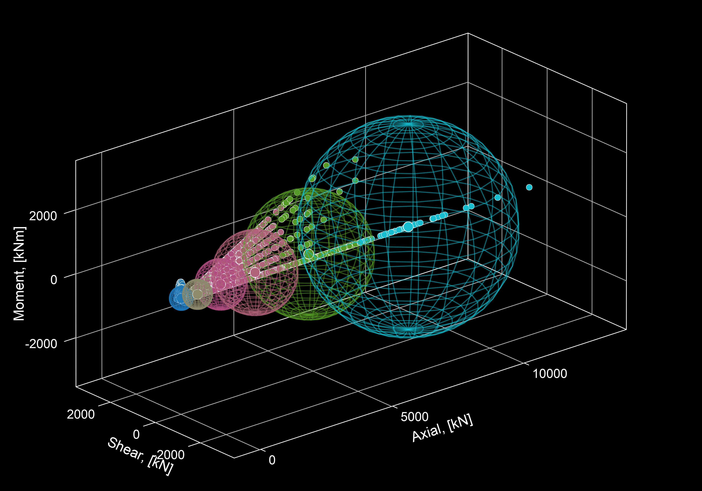

# kjlMakie

Keith's Makie house style: palette with colour ROLES, data-plot themes, structure-drawing
styles and report sizing. Intended for CairoMakie vector output embedded in Typst reports
(`@local/kjl-typst`). Will most likely not work with the `WGLMakie` backend.

```julia
using kjlMakie, CairoMakie; CairoMakie.activate!()
set_theme!(kjl_light)                      # or kjl_grid; kjl_theme(; aspect = nothing) for stacked panels
fig = Figure(size = reportsize(0.5))       # figure units = points: half text width
ax = Axis(fig[1, 1]; xlabel = caps("iteration"), ylabel = caps("compliance [kN·m]"))
lines!(ax, x, ours; label = "OURS", kjl_series(1)...)     # emphasis: blue
lines!(ax, x, other; label = "MMA", kjl_series(2)...)     # the rest: grayscale + linestyle
savereport("trace.pdf", fig)               # 1 pt per unit: embed at natural size → 9 pt text
```

## Colour roles

| role | colour | use |
|---|---|---|
| `kjl_emphasis` | blue | the one highlighted item; everything else grayscale (`kjl_series(i)`, `kjl_grays`) |
| `kjl_alert` | red | a bad item when no other colours are present (failed run, highest cost) |
| `kjl_tension` / `kjl_compression` | blue / red | signed quantities, + / −; zero = white (`force_color`) |
| `kjl_diverging` | red → white → blue | signed fields, with `symmetric_range(v)` |
| `kjl_neutral`, `kjl_sequential` | orange, white → orange | non-force fields (displacement …), `neutral_colormap(v)` |
| `kjl_categorical` | blue, green, yellow, grays | several series compared as equals (never red) |
| internal-force diagrams | black, 50 % fill | one diagram `diagramband!(ax, x, y)`; several: `color = kjl_categorical[i]` |

`kjl_red` is the palette red (same as `kjl_pink`).

## Themes

- `kjl_light`: white/transparent, left + bottom spines, ticks inside, IBM Plex Mono labels and
  ticks, IBM Plex Sans Bold titles, 9 pt, square axes.
- `kjl_grid`: very light-gray panel, white gridlines, no ticks.
- `kjl_dark`: `kjl_light` inverted.
- `kjl_theme(; style, dark, fontsize, aspect, size)`: variants.
- Labels in caps: `caps(s)` keeps `[units]`, Greek and `{protected}` text; `capslabels!(fig)`.
- Legacy: `kjl_light_mono`, `kjl_dark_mono` (old mirrored-tick look).

## Structure drawings

- `structurestyle!(ax::Axis; scale, unit, ground)`: no axes, true aspect, transparent; optional
  light scale ticks with a units label.
- `structurestyle!(ax::Axis3; ground)`: no decorations, `aspect = :data`, optional ground plane.
- `fitlimits!(ax; pad)`, `fitstructure!(fig, ax; width, padpt)`: limits padded from the plotted
  data (nodes and labels at the edges are not clipped) and, for 2D, the figure sized to the
  true aspect.
- `diagramband!(ax, x, y)`: internal-force diagram, black outline + 50 % fill.
- `signedband!(ax, x, y)`: blue/red fill of a generic signed series (not for N/V/M).

Backgrounds are transparent for placement in non-white settings. `GLMakie` needs an opaque
background: `Figure(backgroundcolor = :white)`.

# Examples using kjlMakie




